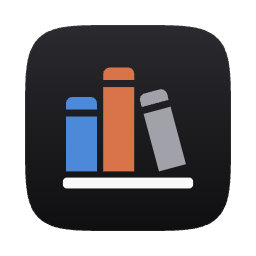
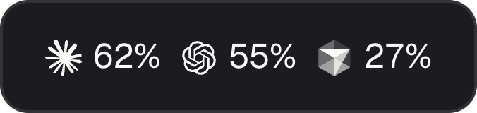
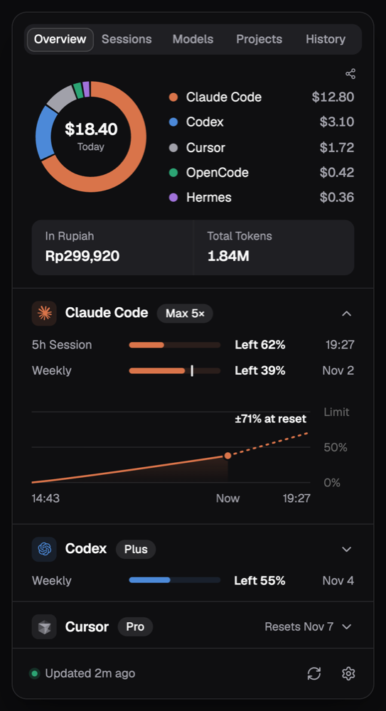
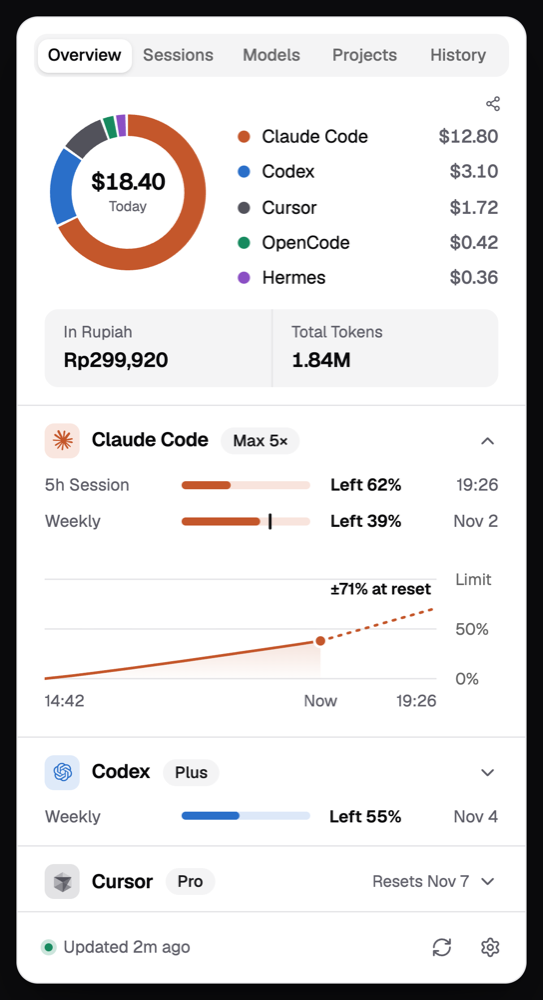

<p align="center">
  
</p>

<h1 align="center">Buku Token</h1>

<p align="center">
  Aplikasi menu bar macOS yang menunjukkan sisa kuota dan biaya agent AI coding kamu.
</p>

<p align="center">
  
</p>

<p align="center">
  
  
</p>

<p align="center"><sub>Semua screenshot memakai data contoh, dan ditampilkan dalam bahasa Inggris.</sub></p>

Kalau kamu menjalankan beberapa agent sekaligus, gampang sekali lupa langganan mana yang hampir habis dan ke mana uangnya pergi. Buku Token membaca log yang memang sudah ditulis agent di Mac kamu, lalu menampilkan jawabannya sekali klik. Tidak perlu membuat akun, dan tidak ada telemetri. Tampilannya tersedia dalam bahasa Indonesia dan Inggris.

[Read in English](README.md)

## Yang ditampilkan

- **Kuota di menu bar:** logo dan persen sisa untuk tiap agent yang punya kuota.
- **Biaya hari ini:** donut per agent, plus total dalam Rupiah dan token.
- **Kuota per agent:** window 5 jam dan mingguan, atau Total, Auto, dan API bulanan untuk Cursor, dengan waktu reset dan proyeksi untuk Claude.
- **Sesi, model, project, dan riwayat:** token dan biaya setara API dari tiap sudut itu.
- **Nilai langganan:** yang kamu bayar dibanding biaya pemakaian yang sama kalau memakai harga API.
- **Notifikasi** (mati bawaannya): saat kuota di bawah 15%, atau saat Claude diperkirakan habis sebelum reset.
- **Kartu share:** gambar yang bisa disalin atau disimpan, dan biayanya bisa disembunyikan.

## Tool yang didukung

| Tool | Token dan biaya | Kuota | Sumber |
|---|---|---|---|
| Claude Code | Ya | Ya | `~/.claude/projects`, dan endpoint pemakaian Anthropic dengan login yang sudah ada |
| Codex | Ya | Ya, sesegar sesi terakhirmu | `~/.codex/sessions` dan `~/.codex/archived_sessions` |
| OpenCode | Ya | Tidak | `~/.local/share/opencode/opencode.db` |
| Hermes | Ya | Tidak | `~/.hermes/state.db` |
| Cursor | Ya, setelah dihubungkan | Ya, setelah dihubungkan | cursor.com, dengan cookie sesi yang kamu tempel |
| OpenRouter | Pengeluaran dan saldo saja | Limit key, kalau ada | openrouter.ai, dengan API key yang kamu tempel |
| Antigravity | Tidak, aktivitas saja | Tidak | Nama dan tanggal file, serta tiga kolom database ringkasannya |
| [RTK](https://github.com/rtk-ai/rtk) | Token yang dihemat | Tidak | Perintah `rtk` |

Angka OpenRouter tidak masuk total, karena pengeluaran yang sama bisa saja sudah terhitung lewat OpenCode atau Hermes.

## Instalasi

```bash
brew install --cask fizipan/tap/buku-token
```

Yang dibutuhkan: [Homebrew](https://brew.sh) dan Mac Apple Silicon. Perbarui dengan `brew upgrade --cask buku-token`, dan hapus dengan `brew uninstall --cask buku-token`. Tambahkan `--zap` kalau data lokal aplikasinya juga mau dihapus.

Saat pertama dibuka, macOS meminta akses ke item Keychain `Claude Code-credentials`. Pilih **Always Allow** supaya kuota Claude terbaca. Kalau ditolak, bagian lain tetap jalan.

**Aplikasi ini belum dinotarisasi Apple.** Tanda tangannya memakai sertifikat self-signed, jadi cask menghapus tanda karantina unduhan supaya macOS mau membukanya. Kalau kamu tidak mau itu, build dari source saja.

DMG juga tersedia di [Releases](https://github.com/fizipan/buku-token/releases). macOS memblokir saat pertama dibuka, jadi buka System Settings, lalu Privacy & Security, dan pilih **Open Anyway**.

### Build dari source

Mac Intel perlu build dari source, dan ini belum pernah diuji di Intel. Yang dibutuhkan: macOS, Node.js, [pnpm](https://pnpm.io), [Rust](https://rustup.rs), dan Xcode Command Line Tools.

**1. Buat sertifikat signing lokal.** Cukup sekali. Dengan identitas yang tetap, macOS mengingat jawaban Keychain kamu setelah build ulang.

1. Buka Keychain Access, lalu pilih Keychain Access > Certificate Assistant > Create a Certificate.
2. Isi Name dengan `Buku Token Local`, Identity Type dengan Self-Signed Root, dan Certificate Type dengan Code Signing.
3. Klik Create, lalu Continue sampai selesai.

`security find-identity -p codesigning` akan menampilkannya sebagai "not trusted". Itu wajar dan tidak menghalangi signing. Untuk memakai identitas lain, ubah `bundle.macOS.signingIdentity` di `src-tauri/tauri.conf.json`.

**2. Build.**

```bash
git clone https://github.com/fizipan/buku-token.git
cd buku-token
pnpm install
pnpm tauri build --bundles app
```

Hasilnya ada di `src-tauri/target/release/bundle/macos/Buku Token.app`. Salin ke `/Applications` untuk dipakai terus.

### Menghubungkan Cursor dan OpenRouter

Keduanya pilihan dan tetap mati sampai kamu hubungkan. Buka Pengaturan, lalu Agent, dan pilih **Kelola**.

- **Cursor:** login di cursor.com, buka developer tools di browser, lalu salin cookie `WorkosCursorSessionToken`. Cursor mengenkripsi login yang tersimpan di Mac, jadi aplikasi ini tidak membacanya. Jaga cookie seperti kata sandi, karena itu sesi akun penuh.
- **OpenRouter:** tempel API key yang sudah dipakai tool kamu. Pemakaian dihitung per key, jadi key baru menampilkan $0.

## Privasi

Data pemakaianmu tetap di Mac, di `~/Library/Application Support/local.toolslab.bukutoken`.

- **Jaringan:** aplikasi hanya pernah menghubungi empat tempat.
  - Endpoint pemakaian Anthropic, untuk membaca kuota Claude.
  - `raw.githubusercontent.com`, untuk daftar harga LiteLLM, hanya saat kamu menekan Perbarui.
  - `cursor.com`, setelah Cursor dihubungkan.
  - `openrouter.ai`, setelah OpenRouter dihubungkan.
- **Kredensial:** login Claude dibaca dari Keychain, dan tidak pernah disimpan, dicatat, atau diperbarui. Cookie Cursor dan key OpenRouter disimpan di item Keychain milik Buku Token. Keduanya dicek ke server sebelum disimpan, dan **Putuskan** menghapusnya. Item Keychain tidak ikut terhapus saat aplikasi dihapus, jadi putuskan dulu.
- **File tool lain** dibuka read-only. Database Hermes dan OpenCode dibaca dari salinan sementara yang langsung dihapus. Database dan Keychain milik Cursor tidak pernah dibuka.
- **Antigravity:** hanya nama dan tanggal file `.pb`, serta id, jumlah langkah, dan tanggal dari database ringkasannya. Judul, pratinjau, file percakapan, dan token Google tidak pernah dibaca.
- **Nama project** dicari dengan menelusuri nama folder dari `/` dan memeriksa `.git`, jadi macOS bisa meminta izin folder. Isi file project tidak dibaca.
- **Kartu share** dibuat di Mac kamu, tanpa nama project, path, email, atau isi percakapan. Nama model kustom tampil sebagai "Model Lain", karena nama itu bisa saja memuat hal pribadi.

Tidak ada telemetri atau analitik.

## Keterbatasan

- Hanya macOS, dan rilisnya untuk Apple Silicon. Aplikasi ini belum dinotarisasi.
- Endpoint Cursor tidak terdokumentasi dan bisa berubah kapan saja, sehingga angkanya bisa berhenti sampai aplikasi diperbarui. Cookie tidak diperbarui otomatis, jadi tempel yang baru saat habis. Menghubungkan akun Cursor lain mencampur riwayat kedua akun.
- Kuota Codex diambil dari log sesi, jadi hanya sesegar sesi Codex terakhirmu.
- Antigravity tidak punya angka token, biaya, atau kuota di sini. Database ringkasannya bisa sedikit tertinggal dari aplikasi yang sedang berjalan.
- Menyembunyikan angka saat layar dibagikan bersifat upaya terbaik. Fitur ini memakai fungsi macOS tidak terdokumentasi yang dicari saat berjalan, bisa terlambat beberapa detik, dan bisa berhenti mendeteksi perekaman di dalam aplikasi pada versi macOS mendatang.
- Notifikasi memakai API macOS lama, dan aplikasi tidak bisa tahu apakah notifikasinya tampil. Pakai **Kirim Tes** di Pengaturan untuk mengeceknya.
- Biaya adalah perkiraan dari harga API, kecuali tool melaporkan biayanya sendiri. Model tanpa harga tampil "–", bukan $0.

## Pengembangan

```bash
pnpm tauri dev                     # jalankan aplikasi
pnpm vitest run                    # tes frontend
pnpm tsc --noEmit                  # cek tipe
cd src-tauri && cargo test         # tes Rust
cd src-tauri && cargo clippy --all-targets -- -D warnings
```

Dibangun dengan Tauri 2, Rust, React, TypeScript, Tailwind CSS, shadcn/ui, dan Recharts. Baca [CONTRIBUTING.md](CONTRIBUTING.md) sebelum membuka pull request, dan [SECURITY.md](SECURITY.md) untuk melaporkan celah keamanan.

## Kredit

- [OpenUsage](https://github.com/robinebers/openusage) menjadi inspirasi fitur share dan tata letak Pengaturan, sekaligus sumber logo Antigravity.
- Harga berasal dari [LiteLLM](https://github.com/BerriAI/litellm), dan sebagian besar logo dari [LobeHub Icons](https://github.com/lobehub/lobe-icons).

## Lisensi

[MIT](LICENSE). Nama produk dan logo adalah milik pemiliknya masing-masing dan dipakai hanya untuk menandai tiap tool. Proyek ini tidak berafiliasi dengan atau didukung oleh mereka.
