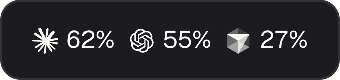
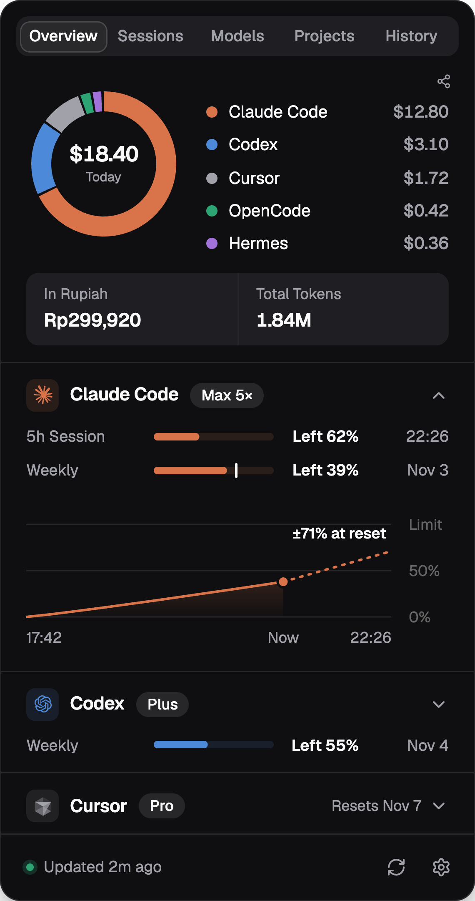
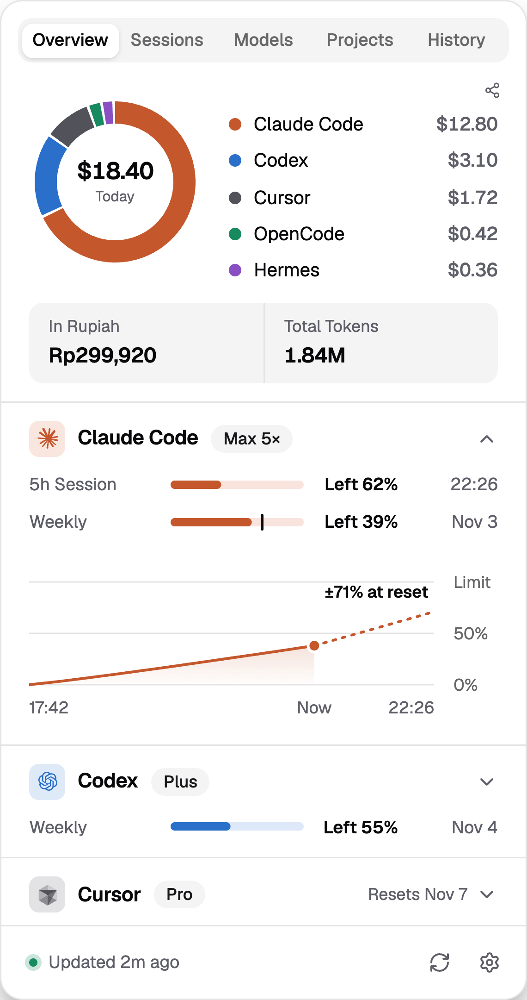
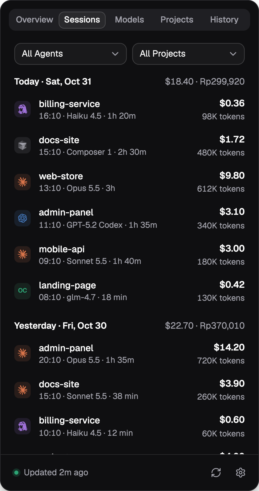
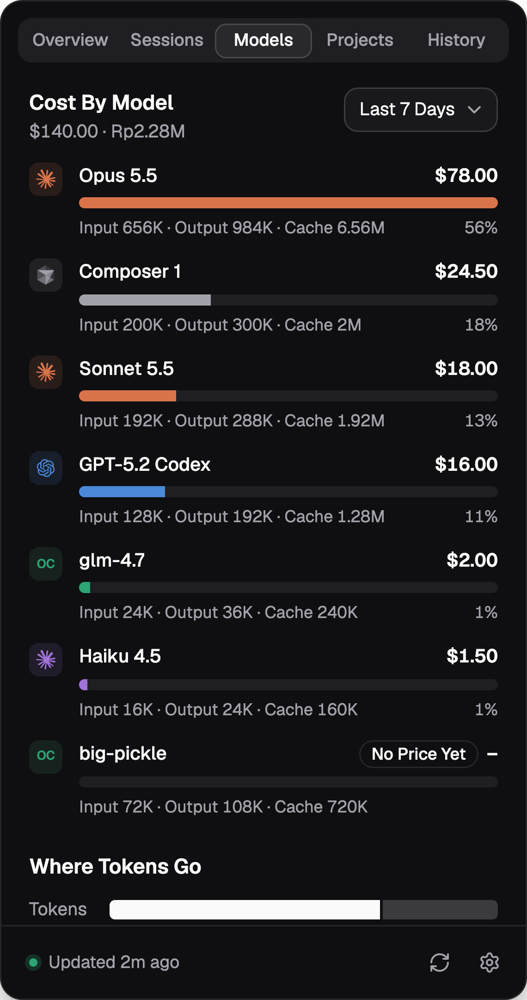
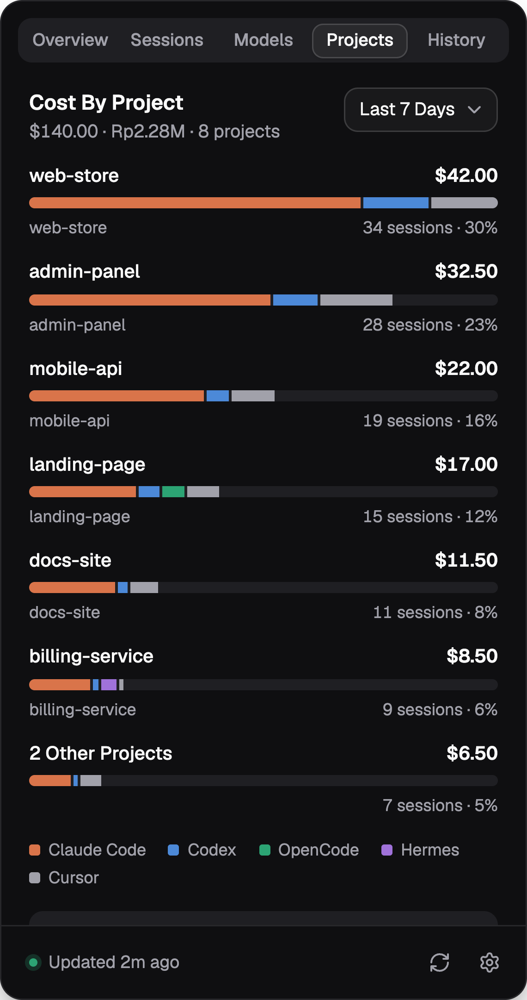
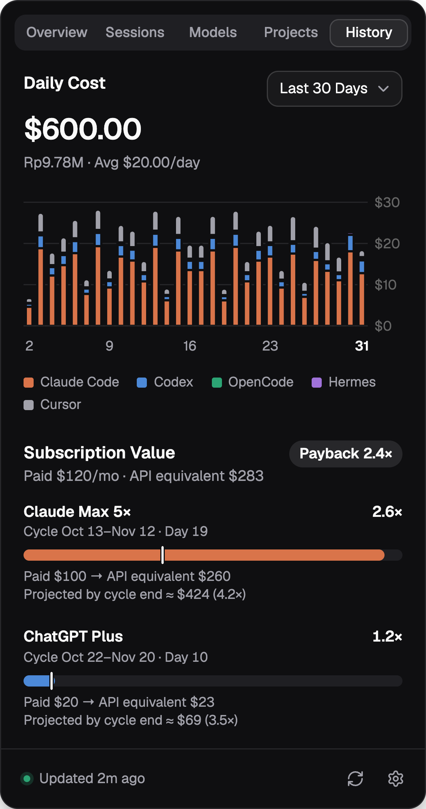
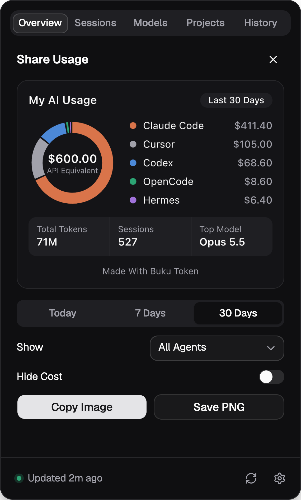
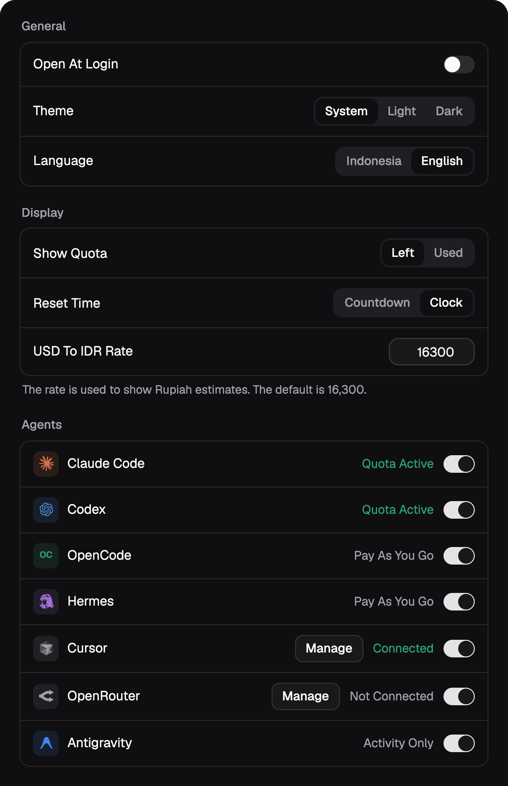

<p align="center">
  
</p>

<h1 align="center">Buku Token</h1>

<p align="center">
  Know what's left, and where it went. A macOS menu bar app for the quota and cost of your AI coding agents.
</p>

<p align="center">
  <a href="https://buku-token.vercel.app"></a>
  <a href="https://github.com/fizipan/buku-token/releases/latest"></a>
  <a href="LICENSE"></a>
  
</p>

<p align="center">English · <a href="README.id.md">Bahasa Indonesia</a></p>

<p align="center">
  
</p>

<p align="center">
  
  
</p>

<p align="center"><sub>All screenshots use example data.</sub></p>

```bash
brew install --cask fizipan/tap/buku-token
```

*Buku* is Indonesian for book. Run a few agents at once and it gets hard to tell which subscription is about to run out, or where the money went. Buku Token reads the logs your agents already write on your Mac and puts the answer one click away. There is no account to create and no telemetry, and the interface comes in English and Indonesian.

## What it shows

**What's left.** The menu bar shows the logo and percentage left for each agent with a quota. Open it for 5-hour and weekly windows, Cursor's monthly Total, Auto and API, reset times, and a burn projection for Claude. Notifications, off by default, warn you when a quota drops below 15% or when Claude is projected to run out before it resets.

**Where it went.** Today's cost as a donut per agent, with the total in Rupiah and tokens, then tokens and API-equivalent cost by session, model, project and day.

**Was it worth it?** What you pay for a subscription next to what the same usage would cost at API prices, projected to the end of the cycle.

**A card to share.** An image you can copy or save, with an option to hide costs. It has no project names, paths or emails.

<table>
  <tr><th>Sessions</th><th>Models</th></tr>
  <tr>
    <td></td>
    <td></td>
  </tr>
  <tr><th>Projects</th><th>History</th></tr>
  <tr>
    <td></td>
    <td></td>
  </tr>
  <tr><th>Share card</th><th>Settings</th></tr>
  <tr>
    <td valign="top"></td>
    <td valign="top"></td>
  </tr>
</table>

## Supported tools

| Tool | Tokens and cost | Quota | Source |
|---|---|---|---|
| Claude Code | Yes | Yes | `~/.claude/projects`, and Anthropic's usage endpoint with your existing login |
| Codex | Yes | Yes, as fresh as your last session | `~/.codex/sessions` and `~/.codex/archived_sessions` |
| OpenCode | Yes | No | `~/.local/share/opencode/opencode.db` |
| Hermes | Yes | No | `~/.hermes/state.db` |
| Cursor | Yes, after you connect it | Yes, after you connect it | cursor.com, with a session cookie you paste in |
| OpenRouter | Spend and balance only | Key limit, if set | openrouter.ai, with an API key you paste in |
| Antigravity | No, activity only | No | File names and dates, and three columns of its summaries database |
| [RTK](https://github.com/rtk-ai/rtk) | Tokens saved | No | The `rtk` command |

OpenRouter figures are kept out of the totals because OpenCode or Hermes may already have counted the same spend.

## Install


```bash
brew install --cask fizipan/tap/buku-token
```

You need [Homebrew](https://brew.sh) and an Apple Silicon Mac. Upgrade with `brew upgrade --cask buku-token`, and remove it with `brew uninstall --cask buku-token`. Adding `--zap` to that also deletes the app's local data.

On first run, macOS asks for access to the Keychain item `Claude Code-credentials`. Choose **Always Allow** to see your Claude quota. If you refuse, everything else still works.

**The app is not notarized by Apple.** It is signed with a self-signed certificate, so the cask removes the download quarantine flag to let macOS open it. If you would rather not allow that, build it from source.

You can also download the DMG from [Releases](https://github.com/fizipan/buku-token/releases). macOS blocks its first open, so go to System Settings, then Privacy & Security, and choose **Open Anyway**.

<details>
<summary><b>Build from source</b></summary>

Intel Macs need to build from source, which has not been tested on Intel. You need macOS, Node.js, [pnpm](https://pnpm.io), [Rust](https://rustup.rs) and the Xcode Command Line Tools.

**1. Create a local signing certificate.** You only do this once. A stable identity means macOS remembers your Keychain answer after a rebuild.

1. Open Keychain Access, then choose Keychain Access > Certificate Assistant > Create a Certificate.
2. Set Name to `Buku Token Local`, Identity Type to Self-Signed Root, and Certificate Type to Code Signing.
3. Click Create, then Continue until it finishes.

`security find-identity -p codesigning` will list it as "not trusted". That is expected and does not stop signing. To use another identity, change `bundle.macOS.signingIdentity` in `src-tauri/tauri.conf.json`.

**2. Build it.**

```bash
git clone https://github.com/fizipan/buku-token.git
cd buku-token
pnpm install
pnpm tauri build --bundles app
```

The app lands in `src-tauri/target/release/bundle/macos/Buku Token.app`. Copy it to `/Applications` to keep it.

</details>

### Connecting Cursor and OpenRouter

Both are optional and stay off until you connect them. Open Settings, go to Agents, and choose **Manage**.

- **Cursor**: log in at cursor.com, open your browser's developer tools, and copy the `WorkosCursorSessionToken` cookie. Cursor encrypts the login it stores on your Mac, so this app does not read that one. Treat the cookie like a password, because it is a full account session.
- **OpenRouter**: paste the API key your tools already use. Usage is counted per key, so a brand-new key shows $0.

## Privacy

Your usage data stays on your Mac, in `~/Library/Application Support/local.toolslab.bukutoken`.

- **Network**: the app only ever talks to four places.
  - Anthropic's usage endpoint, to read your Claude quota.
  - `raw.githubusercontent.com`, for the LiteLLM price list, and only when you press Update.
  - `cursor.com`, once you connect Cursor.
  - `openrouter.ai`, once you connect OpenRouter.
- **Credentials**: the Claude login is read from Keychain, and it is never stored, logged or refreshed. Your Cursor cookie and OpenRouter key sit in Buku Token's own Keychain items. They are checked with the server before being saved, and **Disconnect** deletes them. Keychain items survive uninstalling, so disconnect first.
- **Other tools' files** are opened read-only. Hermes and OpenCode databases are read from a temporary copy that is deleted straight after. Cursor's database and its Keychain are never opened.
- **Antigravity**: only `.pb` file names and dates, plus id, step count and date from its summaries database. Its titles, previews, conversation files and Google token are never read.
- **Project names** come from walking folder names from `/` and checking for `.git`, so macOS may ask for folder access. Project files are not read.
- **The share card** is drawn locally and has no project names, paths, emails or conversation content. Custom model names show as "Other Model", since a name could contain something private.

There is no telemetry or analytics.

## Limitations

- macOS only, and releases are for Apple Silicon. The app is not notarized.
- Cursor's endpoints are undocumented and can change without notice, which would stop its figures until the app is updated. The cookie is not renewed for you, so paste a new one when it expires. Connecting a different Cursor account mixes both accounts' history.
- Codex quota comes from session logs, so it is only as fresh as your last Codex session.
- Antigravity has no token, cost or quota figures here. Its summaries database may lag slightly behind a running app.
- Hiding figures during a screen share is best effort. It uses an undocumented macOS function, looked up at runtime, and can lag a few seconds or stop detecting in-app captures on a future macOS.
- Notifications use an older macOS API, and the app cannot tell whether one was shown. Use **Send Test** in Settings to check.
- Costs are estimates based on API prices unless the tool reports its own, and models with no known price show "–" rather than $0.

## Development

```bash
pnpm tauri dev                     # run the app
pnpm vitest run                    # frontend tests
pnpm tsc --noEmit                  # type check
cd src-tauri && cargo test         # Rust tests
cd src-tauri && cargo clippy --all-targets -- -D warnings
```

Built with Tauri 2, Rust, React, TypeScript, Tailwind CSS, shadcn/ui and Recharts. See [CONTRIBUTING.md](CONTRIBUTING.md) before opening a pull request, and [SECURITY.md](SECURITY.md) to report a vulnerability.

## Credits

- [OpenUsage](https://github.com/robinebers/openusage) was the inspiration for the share feature and Settings layout, and the source of the Antigravity logo.
- Prices come from [LiteLLM](https://github.com/BerriAI/litellm), and most logos from [LobeHub Icons](https://github.com/lobehub/lobe-icons).

## License

[MIT](LICENSE). Product names and logos belong to their owners and are used only to identify each tool. This project is not affiliated with or endorsed by any of them.
